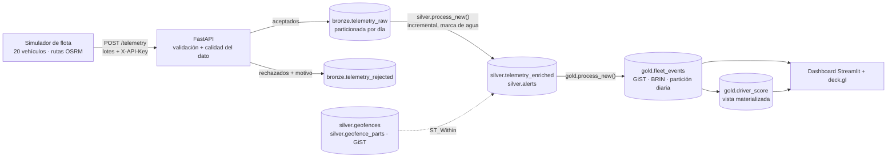
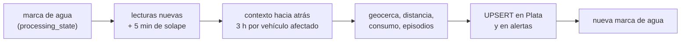

# DESIGN · Arquitectura y decisiones técnicas

Pipeline geoespacial de telemetría vehicular (IoT/AVL) en tres capas, **Bronce → Plata → Oro**, sobre PostgreSQL 16 + PostGIS 3.5.

Este documento explica:

- qué hace cada capa y por qué está construida así;
- cómo se almacenan y consultan millones de coordenadas;
- qué se sacrificó a cambio de rendimiento.

Las cifras de rendimiento son mediciones reales: el detalle está en [`docs/benchmarks.md`](docs/benchmarks.md). Las decisiones, con sus alternativas descartadas, están en [`docs/decisiones.md`](docs/decisiones.md).

---

## 1. Visión general



| Capa | Responsabilidad | Quién escribe | Quién lee |
| --- | --- | --- | --- |
| **Bronce** | Dato crudo tal como llegó, validado, append-only | API (rol `fleet_ingest`) | Solo administradores |
| **Plata** | Geocerca aplicada, límite, distancia, consumo y alertas | `silver.process_new()` | Procesos y administradores |
| **Oro** | Una fila por lectura con todo consolidado y el ID ya enmascarado; Driver Score | `gold.process_new()` | BI: administradores y analistas |

**Principio rector: la lógica espacial vive en PostGIS.** El cruce punto–polígono, las distancias, el consumo y los episodios de alerta se calculan con SQL por lotes (*set-based*), dentro de la base, donde están los datos y los índices. Python se encarga de:

- la ingesta y su validación;
- la orquestación de los procesos;
- la especificación ejecutable de las reglas (sección 9).

---

## 2. Bronce: ingesta y persistencia

### Ingesta por lotes

`POST /telemetry` recibe una lista de paquetes (hasta 1 000) y responde un resumen: aceptados, duplicados, rechazados con motivo y marcados. Los dispositivos AVL reales acumulan lecturas cuando pierden señal y las envían juntas; los lotes además reducen las idas y vueltas por red.

- **Medido:** 24 h simuladas, 115 220 paquetes, ingeridos en 138 s por la API en un portátil.
- **Autenticación:** API key por rol en el header `X-API-Key`. Los roles son `device`, `admin` y `analyst`. La comparación usa `secrets.compare_digest`, que tarda lo mismo acierte o falle, para no filtrar información por tiempos de respuesta.
- **Validación en dos niveles:**
  1. **Pydantic:** formato y rangos físicos. `vehicle_id` con el patrón `VHC-0000-AAA`; timestamp obligatorio **con zona horaria**; latitud y longitud en rango; velocidad entre 0 y 250; combustible entre 0 y 100; sin NaN ni infinitos.
  2. **Reglas de contexto** ([`ingestion/quality.py`](src/fleet_pipeline/ingestion/quality.py)): dependen de la fecha actual, del territorio o de la lectura anterior.

### Calidad del dato: rechazar, ignorar o marcar

Un GPS real envía basura: coordenadas (0, 0), fechas absurdas, saltos imposibles. Cada paquete tiene uno de tres destinos:

| Resultado | Casos | Por qué |
| --- | --- | --- |
| **Rechazar** (a `bronze.telemetry_rejected` con su motivo) | Campos vacíos; ID mal formado; fecha más de 5 min en el futuro o de hace más de 7 días; lat o lon exactamente 0 (firma de "sin señal"); fuera del rectángulo de Colombia; **salto imposible**: más de 200 km/h implícitos contra la lectura anterior y al menos 100 m de distancia | Es físicamente imposible. Queda trazado, nada se pierde en silencio. |
| **Ignorar** | Duplicado exacto (`vehicle_id`, `ts`) | El reenvío es normal en los dispositivos: la ingesta es **idempotente**. |
| **Guardar con bandera** (`quality_flags`) | Cambio de velocidad mayor a 30 km/h por segundo; caída de combustible de 5 puntos o más en 10 minutos o menos | Es sospechoso pero posible (frenada de emergencia, robo de combustible): se conserva para el análisis. |

El umbral de 100 m en el salto imposible evita falsos rechazos por ruido: 60 m de deriva del GPS en 1 s ya dan 216 km/h implícitos. Las distancias se calculan sobre el elipsoide WGS84 con pyproj y se validaron contra `geography` de PostGIS: coinciden al milímetro.

### Almacenamiento masivo de coordenadas

```sql
bronze.telemetry_raw (
    vehicle_id text, ts timestamptz, lat, lon, speed_kmh, fuel_pct,
    geom geometry(Point, 4326),        -- generada a partir de lat y lon
    quality_flags text[], received_at timestamptz,
    PRIMARY KEY (vehicle_id, ts)       -- idempotencia + acceso por vehículo
) PARTITION BY RANGE (ts);             -- una partición por día
```

- **Partición diaria por `ts`**, cortada a la **medianoche de Colombia** y no de UTC. Con cortes en UTC, un viaje de las 7:00 p. m. quedaba partido en dos días y el Driver Score diario mezclaba jornadas. Los cortes se calculan con `AT TIME ZONE 'America/Bogota'` dentro de la función, así que no dependen de la zona horaria de la sesión.
- **Ventajas de particionar:**
  - Las consultas por fecha solo leen los días necesarios (*partition pruning*).
  - La retención se hace con un `DROP TABLE` instantáneo de la partición, en lugar de un `DELETE` masivo que genera *bloat* y carga de vacuum.
  - Una partición `DEFAULT` recibe lo que no tenga partición, así que nunca se pierde un dato.
- **Índices mínimos:** la PK B-tree `(vehicle_id, ts)` y un **BRIN** en `ts` y `received_at`. **Bronce no tiene GiST**: es de escritura intensiva, cada índice encarece cada inserción y nadie hace consultas espaciales sobre el dato crudo. En el cruce con geocercas, el índice que trabaja es el GiST de las geocercas, no el de los puntos.
- **Append-only:** el rol `fleet_ingest` solo puede `INSERT` y `SELECT` en Bronce, sin `UPDATE` ni `DELETE`.

**Volumen de referencia (estimado, no medido):** una flota de 10 000 vehículos que reporta cada 30 s genera unos 28,8 millones de filas por día. Con unos 220 bytes por fila, medidos en Bronce con índices, son ~6 GB por día. Ese orden de magnitud justifica las particiones diarias.

---

## 3. Privacidad: enmascaramiento del ID

El enunciado pide mostrar `VHC-****-ABC` a los usuarios no administradores. La implementación va un paso más allá, por una razón práctica: **la máscara colisiona**. Dos vehículos con las mismas letras (`VHC-1234-ABC` y `VHC-9876-ABC`) se verían iguales y se rompería el análisis por vehículo.

| Mecanismo | Qué hace |
| --- | --- |
| `analytics.mask_vehicle_id(text)` | `VHC-8472-ABC` → `VHC-****-ABC`. A prueba de fallos: un ID con formato inesperado se devuelve totalmente enmascarado. |
| **Clave sustituta** `vehicle_key` | Entero sin significado que distingue vehículos. Solo un administrador puede unirla con el ID real (**seudonimización**). |
| Roles de PostgreSQL | `bi_admin` lee todo. `bi_analyst` **solo** tiene permiso sobre el esquema `analytics` (vistas enmascaradas) y sobre Oro. No puede leer Bronce ni Plata. |
| Oro sin IDs reales | `gold.fleet_events` guarda solo la clave y el ID enmascarado: **privacidad por diseño**. |
| API y dashboard | Asumen en la base el rol de quien consulta (`SET LOCAL ROLE`). Aunque el código de la aplicación tuviera un error, **la base aplica la regla** (defensa en profundidad). |

Se descartó un hash del ID: solo hay 10⁴ × 26³ ≈ 175 millones de IDs posibles, y un hash se revierte por fuerza bruta en segundos.

Los tests de integración comprueban que el analista nunca recibe un ID real: ni por la API, ni por las consultas del dashboard, ni leyendo directamente Bronce, donde la base le niega el permiso.

---

## 4. Plata: analítica espacial y enriquecimiento

### Geocercas de prueba, construidas con datos reales

[`data/geofences/geofences.geojson`](data/geofences/geofences.geojson) contiene 25 polígonos. Fuentes y licencias en [`SOURCES.md`](data/geofences/SOURCES.md).

| Tipo | Cantidad | Límite | Origen |
| --- | --- | --- | --- |
| `urban`: perímetro urbano de Bogotá y Medellín | 2 | 50 km/h (ley) | Datos oficiales de cada alcaldía |
| `school`: zonas escolares | 10 | 30 km/h (ley) | DBSCAN sobre colegios + buffer de ~100 m |
| `high_risk`: puntos críticos de siniestralidad | 10 + 1 | 40 km/h en ciudad; 60 en Guarne (política de flota) | DBSCAN sobre siniestros reales |
| `road_hazard`: vía deteriorada (El Santuario–Caño Alegre) | 1 | 70 km/h (política de flota) | Tramo de 135 km sobre la ruta, desde El Santuario |
| `highway`: corredor Bogotá–Medellín | 1 | 90 km/h (ley) | Ruta OSRM con buffer de 30 m |

- **Límites legales:** Ley 2251 de 2022 (art. 106 del Código Nacional de Tránsito) y Resolución 25995 de 2023 del Ministerio de Transporte. Las zonas que la ley no define llevan un límite de **política de la flota**, más estricto. Cada geocerca registra el origen de su límite (`limit_source = law | fleet_policy`).
- **Puntos críticos:** se detectan con `ST_ClusterDBSCAN` en EPSG:9377 (metros). Se toman los 5 clusters más densos por ciudad, y cada uno se convierte en polígono con su envolvente convexa + 50 m.
- **Depuración previa de los siniestros de Medellín:** se excluyeron las coordenadas con más de 150 registros, que son ubicaciones por defecto de direcciones no geocodificadas.

### El cruce punto–polígono

```sql
LEFT JOIN LATERAL (
    SELECT g.geofence_id, g.code, g.zone_type, g.speed_limit_kmh
    FROM silver.geofence_parts AS p                 -- GiST: filtro por rectángulo envolvente
    JOIN silver.geofences AS g USING (geofence_id)
    WHERE ST_Within(t.geom, p.geom)                 -- prueba exacta solo con las candidatas
    ORDER BY g.speed_limit_kmh, <prioridad de riesgo>, g.code
    LIMIT 1                                         -- la geocerca más restrictiva
) AS z ON true
```

**Cómo lo resuelve PostgreSQL**, en dos fases:

1. El índice **GiST** compara el punto con los rectángulos envolventes de los polígonos y descarta casi todos sin tocar su geometría.
2. `ST_Within` hace la prueba exacta, que es costosa, solo con las pocas candidatas.

**`ST_Subdivide`: optimización medida.** El GiST trabaja con rectángulos envolventes. El polígono del corredor tiene 33 427 vértices y un rectángulo que cubre Bogotá y Medellín, así que nunca se descartaba. Por eso el cargador genera `silver.geofence_parts`: cada geocerca se parte en piezas de **256 vértices como máximo** (439 piezas en total), cada una con un rectángulo ajustado y su propio GiST.

- **Medido** con `EXPLAIN ANALYZE` sobre 113 000 lecturas: **10 653 ms → 1 736 ms (6,1×)**.
- Un test de integración comprueba, con 3 000 puntos al azar, que las piezas dan **exactamente** el mismo resultado que los polígonos completos.

**Reglas del cruce:**

- Si un punto está en varias geocercas (por ejemplo, una zona escolar dentro del perímetro urbano), **gana la más restrictiva**: el menor límite y, en empate, la de mayor riesgo.
- Fuera de toda geocerca rige el límite por defecto de 90 km/h.
- **Borde:** `ST_Within` no cuenta como "dentro" un punto exactamente sobre el borde. Esa semántica está probada tanto en PostGIS como en Shapely.

### Alertas de velocidad con límite dinámico

```text
umbral = límite de la geocerca aplicada + 5 km/h          (tolerancia por ruido del GPS)
episodio = 2 o más lecturas consecutivas sobre el umbral  (un pico aislado no alerta)
severidad = (velocidad máxima − límite) / límite:  ≤ 20 % leve · ≤ 50 % moderada · > 50 % grave
```

- **Episodios, no lecturas.** Lecturas consecutivas en exceso forman **una sola alerta**, resuelta en SQL con *gaps and islands* y funciones de ventana. El episodio se corta si cambia la geocerca o si pasan más de 30 s entre lecturas. Así, un exceso de 2 minutos es una infracción y no 12.
- **`GEOFENCE_VIOLATION` frente a `SPEEDING`.** Si el límite aplicado viene de una zona especial (escolar, siniestralidad, vía deteriorada), el episodio es una infracción de geocerca. Si viene del límite general (urbano o carretera), es un exceso de velocidad.

### Consumo predictivo: ¿alcanza el combustible?

```text
consumo (L/km)      = combustible gastado / distancia recorrida   (últimos 20 km, reales)
km restantes        = ST_LineLocatePoint(ruta, posición) y sentido del viaje
combustible necesario = km restantes × consumo × 1,15            (15 % de reserva)
alerta LOW_FUEL_FOR_ROUTE si  combustible actual (L) < combustible necesario
severidad por cobertura = actual / necesario:  < 50 % grave · < 80 % moderada · resto leve
```

- **Consumo real, no de catálogo.** Se mide sobre los últimos 20 km del propio vehículo, con el nivel de combustible suavizado. Con menos de 5 km de historia se usa el consumo de referencia del modelo.
- **Recargas:** si el nivel sube más de 5 puntos, la ventana se reinicia, para no medir un "consumo negativo".
- **Vehículo detenido y ruido GPS:** si la velocidad es 0 o el paso mide menos de 15 m, no se suma distancia. Sin esto, la deriva de un vehículo parqueado inflaría los km.
- **Ruta planificada:** cada vehículo tiene una ruta asignada (`silver.routes`). `ST_LineLocatePoint` sobre la línea en EPSG:9377 da la fracción recorrida, y el sentido del viaje dice cuánto falta.
- **Antiparpadeo:** se exigen 2 lecturas seguidas bajo el umbral y se emite una alerta por trayecto.
- **Validado con los datos simulados:** el consumo estimado (35,4–35,9 L/100 km) coincide con el real del simulador (35 L/100 km más la penalización por conducción brusca).

### Procesamiento incremental

`silver.process_new()` es una función SQL que procesa solo lo recibido desde la última **marca de agua** (`received_at`):



- **Datos tardíos:** el solape de 5 minutos recoge las lecturas que llegaron con atraso.
- **Episodios que cruzan lotes:** el contexto de 3 horas permite que un episodio que empezó en un lote y sigue en otro se reconstruya completo.
- **Idempotencia:** todo es `UPSERT`, así que reprocesar no duplica alertas. Hay un test que lo comprueba.
- **Medido:** 112 953 lecturas procesadas en ~8 s, con 2 148 alertas.

---

## 5. Oro: modelamiento para BI

### `gold.fleet_events`: la tabla consolidada

Una fila por lectura, con todo lo que un analista necesita sin hacer joins:

- clave sustituta, ID enmascarado y tipo de vehículo;
- hora y día de negocio;
- punto, velocidad, límite aplicado y exceso;
- geocerca y tipo de zona;
- episodio de alerta (tipo y severidad);
- combustible en % y en litros, km restantes, ruta y distancia del paso.

- **Carga incremental** desde Plata con su propia marca de agua y `UPSERT`. Se eligió una tabla y no una vista materializada, porque una vista materializada se recalcula entera en cada refresco y eso no escala a millones de filas.
- **Partición diaria** y PK `(vehicle_key, ts)`.

### Driver Score

Es un puntaje diario de 0 a 100 por vehículo. La fórmula es simple, explicable y verificable:

```text
puntos = Σ episodios × peso por severidad (leve 1 · moderada 3 · grave 6)
         × 2 si es GEOFENCE_VIOLATION        (exceder en zona escolar pesa el doble)
score  = 100 × e^(−0,005 × puntos por cada 100 km)
```

- **Normalizado por 100 km**, para no castigar a quien más recorre.
- **Exponencial y no resta lineal.** Con una resta lineal, los conductores normales y los agresivos quedaban todos en 0. Con la exponencial, cada 100 puntos por cada 100 km reducen el puntaje ~40%, y el puntaje nunca se satura.
- **Separa perfiles** con los datos simulados: prudentes 89–100, normales 46–72, agresivos 18–44.
- **Exclusiones:**
  - Con menos de 5 km en el día no se calcula el puntaje.
  - La alerta de combustible no resta: es planeación de la ruta, no conducción.
- **Trazable:** `gold.driver_score` guarda todos los componentes (km, conteos por tipo y severidad, puntos), así que cualquier puntaje se puede recalcular a mano. Es una vista materializada pequeña (vehículos × días), con índice único para refrescarla `CONCURRENTLY` sin bloquear lecturas.

### Variables para la optimización de rutas B2B

Oro deja listas, por vehículo, día, tramo o geocerca:

- km recorridos y consumo real (L/100 km);
- tiempo y distancia en zonas de riesgo;
- excesos por geocerca: puntos calientes por zona;
- autonomía frente a la distancia restante de la ruta.

Son variables directas para un modelo de asignación o ruteo, por ejemplo para evitar corredores con alta siniestralidad o para planificar la recarga antes de salir.

---

## 6. Sistemas de coordenadas

| Uso | Sistema | Por qué |
| --- | --- | --- |
| Almacenamiento | **EPSG:4326** (WGS84) | Es el sistema en que reporta el GPS y el que usan los mapas web. Sin transformación en la ingesta. |
| Distancias y consumo | **`geography`** (elipsoide WGS84) | Metros reales sin elegir proyección. |
| Operaciones planas: DBSCAN, buffers, `ST_LineLocatePoint` | **EPSG:9377** (MAGNA-SIRGAS Origen Nacional) | Es el sistema oficial de Colombia. Un solo plano métrico cubre Bogotá, Medellín y el corredor. |

La imagen `postgis/postgis:16-3.5` trae PROJ 7.2.1, que no incluye EPSG:9377. Por eso [`db/init/02_srid_9377.sql`](db/init/02_srid_9377.sql) lo registra con la definición oficial del IGAC, sin depender de la versión de PROJ.

**Verificación:** el origen (4° N, 73° O) se proyecta exactamente en (5 000 000, 2 000 000). La ida y vuelta 4326 → 9377 → 4326 tiene un error de 0 m. Las longitudes de ruta en 9377 difieren menos de 0,5% de las geodésicas (está probado).

---

## 7. Estrategia de índices y resultados del benchmark

### Qué índice va dónde

| Tabla | Índice | Para qué consulta |
| --- | --- | --- |
| `bronze.telemetry_raw` | PK B-tree `(vehicle_id, ts)` + BRIN `ts` | Idempotencia, lectura incremental, ruta por vehículo |
| `silver.geofence_parts` | **GiST** `geom` | Cruce punto–polígono (`ST_Within`) |
| `gold.fleet_events` | **GiST** `geom` | "¿Qué pasó en esta zona o en este rectángulo del mapa?", y vecinos cercanos (KNN) |
| `gold.fleet_events` | **GiST parcial** `geom WHERE alert_type IS NOT NULL` | Heatmap de infracciones: indexa solo la fracción con alertas |
| `gold.fleet_events` | **BRIN** `ts` | Rangos de tiempo, a un costo de kilobytes |
| `gold.fleet_events` | PK B-tree `(vehicle_key, ts)` | La ruta de un vehículo en un día |

**¿Por qué GiST y no B-tree para la geometría?** Un B-tree ordena valores en una sola dimensión. GiST indexa rectángulos envolventes en un árbol tipo R-tree, que responde preguntas de dos dimensiones: "se intersecta con", "está dentro de", "más cercano a".

**¿Por qué BRIN para el tiempo?** La telemetría llega casi en orden cronológico, así que cada bloque de disco contiene un rango estrecho de horas. BRIN guarda solo el mínimo y el máximo por grupo de bloques: con 5 millones de filas ocupa **40 kB, frente a 153 MB** del B-tree.

### Resultados (5 078 880 filas, medianas de `EXPLAIN ANALYZE`)

PostgreSQL 16.9 · PostGIS 3.5.2 · Docker en un portátil con Windows 11. Generado por [`scripts/benchmark.py`](scripts/benchmark.py).

| Consulta de BI | Sin índices | Con índices | Particionada + índices | Mejora |
| --- | ---: | ---: | ---: | ---: |
| **Heatmap:** infracciones en ~5 × 5 km del centro de Bogotá, 7 días | 189,2 ms | 117,0 ms | **24,4 ms** | 7,8× |
| **Ruta:** un vehículo en un día, ordenada | 151,1 ms | **3,0 ms** | 3,3 ms | 50× |
| **Geocerca:** eventos dentro de una zona escolar (`ST_Within`) | 3 227,7 ms | **83,8 ms** | 88,4 ms | 39× |
| **Vecinos:** 10 eventos más cercanos a un punto (KNN `<->`) | 817,8 ms | **0,1 ms** | 3,5 ms | 5 602× |

| Índice | Tiempo de creación | Tamaño |
| --- | ---: | ---: |
| GiST en `geom` | 4,5 s | 200 MB |
| GiST parcial (solo alertas) | 0,8 s | 14 MB |
| BRIN en `ts` | 0,5 s | 40 kB |
| B-tree `(vehicle_key, ts)` | 2,0 s | 153 MB |

### Hallazgos

1. **Un índice no siempre ayuda.** Con 1 millón de filas (9 días), el heatmap de 7 días fue *más lento* con índices (58 → 102 ms). La consulta abarcaba casi toda la tabla, y el planificador combinó BRIN y GiST con un costo mayor que leerla entera. El *partition pruning* lo resolvió: descarta los días fuera del rango **antes** de usar el índice (25 ms).
2. **La partición tiene un costo.** Las consultas sin filtro de tiempo recorren todas las particiones: el KNN pasa de 0,1 a 3,5 ms (`Merge Append` sobre 46 particiones). Se acepta, porque en un tablero de flotas casi todo se consulta por rango de fechas, y 3,5 ms sigue estando en milisegundos.
3. **El GiST parcial es 14 veces más pequeño** que el completo y sirve exactamente para la capa más consultada del tablero.

---

## 8. Trade-offs para Big Data

| Decisión | Se gana | Se sacrifica | Mitigación |
| --- | --- | --- | --- |
| Lógica en SQL por lotes dentro de PostGIS | Rendimiento (los datos no salen de la base), uso de índices, una sola transacción | El SQL es más difícil de probar en aislamiento | Las reglas también están en Python como especificación, y un test verifica que ambos dan lo mismo |
| Procesamiento por lotes incremental, no *streaming* | Simplicidad, idempotencia, reprocesamiento trivial | Latencia de segundos a minutos entre lectura y alerta | La marca de agua permite correr el proceso cada pocos segundos |
| Bronce sin GiST | Inserción más barata | Sin consultas espaciales sobre el dato crudo | Nadie las necesita: se consulta Oro |
| Partición diaria | Pruning, retención con `DROP` | Más objetos; las consultas sin rango de tiempo cuestan más | Rango de fechas en todas las consultas del tablero |
| Oro desnormalizado (una fila por lectura) | Consultas sin joins, en milisegundos | Más almacenamiento | BRIN y GiST parcial mantienen bajo el costo de los índices |
| Tabla Oro incremental en lugar de vista materializada | Costo proporcional a lo nuevo | Lógica de carga más compleja | `UPSERT` con marca de agua, probado |
| Episodios en lugar de lecturas | Alertas con sentido de negocio; heatmap sin inflar | Las alertas se cierran con retraso | Contexto hacia atrás de 3 horas al procesar |

### Cómo escalaría a producción

Lo siguiente **no está implementado**: es la evolución natural, en orden de necesidad.

1. **Gestión de particiones** con `pg_partman` y `pg_cron`: creación anticipada, retención automática y compresión o archivo de particiones antiguas.
2. **Ingesta desacoplada** con una cola (Kafka, Kinesis o Pub/Sub) delante de la API, con escritura por `COPY` en lote para absorber picos.
3. **Procesamiento continuo:** el mismo `silver.process_new()` programado cada pocos segundos, o *streaming* con estado (Flink) si la latencia de las alertas debe bajar del segundo.
4. **Réplicas de lectura** para BI, de modo que el tablero no compita con la ingesta.
5. **Escala horizontal** con Citus (distribución por `vehicle_key`) o con TimescaleDB (*hypertables* y compresión columnar) cuando un solo nodo no alcance.
6. **Agregación espacial** con índices H3 precalculados para heatmaps a escala nacional.

---

## 9. Calidad y pruebas

- **Reglas duplicadas a propósito.** [`processing/rules.py`](src/fleet_pipeline/processing/rules.py) expresa cada regla de negocio como funciones puras de Python, probadas con unit tests y casos borde: geocerca más restrictiva, umbral, severidad, episodios, recargas, consumo, km restantes, Driver Score. El SQL es el ejecutor a escala. Los tests de integración verifican que ambos coinciden; por ejemplo, el Driver Score de SQL es igual al de Python.
- **Geocercas:**
  - unit tests sobre el dataset real: dentro, fuera, en el borde, la zona más restrictiva y el cambio de límite a pocos metros;
  - integración: PostGIS y Shapely coinciden en 3 000 puntos al azar, las piezas subdivididas dan el mismo resultado y el plan de consulta usa el GiST.
- **Integración contra PostGIS real:** ingesta idempotente, rechazos, permisos por rol, enmascaramiento, procesamiento de Plata y Oro, consultas del dashboard. Los tests crean sus propios vehículos y los borran al terminar.
- **CI en GitHub Actions** en cada push:
  1. lint y formato con `ruff`;
  2. PostGIS como servicio, inicializado con los mismos scripts de `db/init/`;
  3. toda la suite con cobertura mínima de 80%.

  En CI, los tests de integración **fallan** si no hay base de datos, en lugar de saltarse.
- **Código:**
  - tipado y módulos pequeños por capa (`ingestion`, `processing`, `security`, `queries`, `simulator`);
  - SQL siempre parametrizado y configuración por variables de entorno;
  - logging en lugar de `print`, sin IDs reales en los logs;
  - `pre-commit` con `ruff` y detección de claves privadas.

---

## 10. Supuestos y límites conocidos

- **Los datos son simulados.** Las rutas son reales (OSRM sobre OpenStreetMap), y los conductores tienen perfiles prudente, normal y agresivo que conocen el límite de cada tramo. El simulador inyecta ~2% de paquetes defectuosos y un camión que sale sin combustible suficiente, para ejercitar las reglas.
- **El combustible llega en porcentaje**, como lo mide un sensor de nivel. Los litros se derivan de la capacidad del tanque del catálogo de vehículos.
- **El límite por defecto es 90 km/h** (carretera nacional) fuera de toda geocerca. Es configurable, igual que la tolerancia, el número mínimo de lecturas y los umbrales de severidad: todos son parámetros de `silver.process_new()`.
- **Horizonte de ingesta de 7 días:** las particiones se crean para esa ventana, y una lectura más antigua se rechaza por regla de calidad.
- **Un solo nodo.** El diseño (particiones, índices, procesamiento incremental) es el que permite pasar a varios nodos sin reescribir la lógica.
