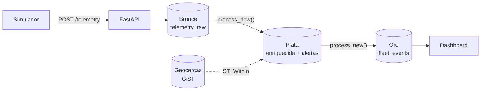

# Fleet Pipeline · Telemetría vehicular geoespacial

[](https://github.com/saul-gut/fleet-pipeline/actions/workflows/ci.yml) [](https://fleet-pipeline-saul.streamlit.app/)

Pipeline de datos geoespaciales para flotas (IoT/AVL) con arquitectura **Bronce → Plata → Oro** sobre **PostgreSQL 16 + PostGIS 3.5**. Recibe telemetría GPS, la valida y la cruza con geocercas. A partir de ahí:

- dispara alertas de velocidad con un límite que depende de la zona;
- predice si el combustible alcanza para terminar la ruta;
- calcula un **Driver Score** diario por vehículo.

Todo se consolida en una tabla para BI que responde en milisegundos sobre millones de registros.


**[Ver el tablero en línea →](https://fleet-pipeline-saul.streamlit.app/)** Es una demo pública, sin instalar nada ni usar contraseñas. Muestra una foto de la capa Oro consultada con DuckDB; en local, el mismo tablero consulta PostGIS ([D-26](docs/decisiones.md#d-26--demo-pública-con-una-foto-de-oro-en-duckdb)).

> Si nadie la ha abierto en las últimas horas, Streamlit la despierta con un botón y tarda unos 30 segundos en cargar.

---

## Qué incluye

| Capa | Qué hace | Dónde |
| --- | --- | --- |
| **Bronce** | API FastAPI que recibe lotes de telemetría, valida la calidad del dato (rechaza, ignora duplicados o marca), y guarda en una tabla particionada por día. Un simulador envía la flota por la API en tiempo real o en modo histórico. | [`ingestion/`](src/fleet_pipeline/ingestion), [`api/`](src/fleet_pipeline/api), [`simulator/`](src/fleet_pipeline/simulator) |
| **Privacidad** | Enmascara el ID (`VHC-8472-ABC` → `VHC-****-ABC`) para los no administradores, con roles de PostgreSQL, vistas enmascaradas y una clave sustituta. La base aplica la regla aunque la aplicación falle. | [`05_security.sql`](db/init/05_security.sql), [`security/`](src/fleet_pipeline/security) |
| **Plata** | Cruza cada punto con 25 geocercas construidas con datos oficiales de Bogotá y Medellín (`ST_Within` + GiST). Aplica el límite de la geocerca más restrictiva, agrupa los excesos en episodios y diferencia `SPEEDING` de `GEOFENCE_VIOLATION`. Calcula el consumo real para la alerta `LOW_FUEL_FOR_ROUTE`. | [`08_silver_process.sql`](db/init/08_silver_process.sql), [`rules.py`](src/fleet_pipeline/processing/rules.py) |
| **Oro** | `gold.fleet_events`: tabla consolidada con GiST, GiST parcial, BRIN y partición diaria, sin IDs reales. Driver Score diario normalizado por 100 km. | [`09_gold.sql`](db/init/09_gold.sql) |
| **Tablero** | Streamlit + deck.gl: ruta del vehículo, heatmap o hexágonos de infracciones, geocercas, alertas de combustible, ranking de Driver Score y cambio de rol en vivo (administrador o analista). | [`dashboard/`](dashboard) |

## Requisitos y dónde se cumplen

| Requisito | Implementación | Verificación |
| --- | --- | --- |
| Servicio que simula la transmisión en tiempo real de dispositivos IoT/AVL | API [`POST /telemetry`](src/fleet_pipeline/api/ingest.py) + [simulador](src/fleet_pipeline/simulator) en modo histórico y en vivo | [`test_ingest_api.py`](tests/integration/test_ingest_api.py) |
| Paquete con ID, timestamp, latitud y longitud decimales, velocidad y combustible | [`TelemetryPacket`](src/fleet_pipeline/ingestion/schemas.py) y [reglas de calidad](src/fleet_pipeline/ingestion/quality.py) | [`test_quality.py`](tests/unit/test_quality.py) |
| Persistencia en PostgreSQL + PostGIS | [`docker-compose.yml`](docker-compose.yml) y [`04_bronze.sql`](db/init/04_bronze.sql), particionada por día | [CI](.github/workflows/ci.yml) con PostGIS real |
| Enmascaramiento del ID (`VHC-****-ABC`) para no administradores | Roles y vistas en [`05_security.sql`](db/init/05_security.sql); rol por petición en [`security/`](src/fleet_pipeline/security) | [`test_masking.py`](tests/integration/test_masking.py) |
| Geocercas de prueba: perímetros urbanos y zonas de alta siniestralidad | 25 polígonos en [`geofences.geojson`](data/geofences/geofences.geojson), de [fuentes oficiales](data/geofences/SOURCES.md) | [`test_geofences.py`](tests/unit/test_geofences.py) |
| Dentro o fuera de la geocerca con `ST_Within` | Cruce con GiST en [`08_silver_process.sql`](db/init/08_silver_process.sql) | [`test_geofences_sql.py`](tests/integration/test_geofences_sql.py): PostGIS = Shapely en 3 000 puntos |
| Alerta de exceso de velocidad con límite dinámico según la geocerca | Geocerca más restrictiva y episodios en [`08_silver_process.sql`](db/init/08_silver_process.sql), especificados en [`rules.py`](src/fleet_pipeline/processing/rules.py) | [`test_rules.py`](tests/unit/test_rules.py), [`test_silver.py`](tests/integration/test_silver.py) |
| Alerta predictiva si el combustible no alcanza para la ruta | Consumo real y km restantes (`ST_LineLocatePoint`) en los mismos archivos | [`test_rules.py`](tests/unit/test_rules.py) |
| Driver Score | Vista `gold.driver_score` en [`09_gold.sql`](db/init/09_gold.sql) | [`test_gold.py`](tests/integration/test_gold.py): SQL = Python |
| Tabla consolidada con índices GiST, en milisegundos sobre millones de registros | `gold.fleet_events` en [`09_gold.sql`](db/init/09_gold.sql) | [Benchmark con 5 M filas](docs/benchmarks.md) |
| Tablero con la ruta del vehículo y un heatmap de infracciones | [`dashboard/`](dashboard) | [`test_dashboard_queries.py`](tests/integration/test_dashboard_queries.py) |
| Pruebas unitarias de geocercas y cálculos predictivos | [`tests/unit/`](tests/unit) y [`tests/integration/`](tests/integration) | 232 tests en el [CI](.github/workflows/ci.yml) |
| Documentación de diseño y de despliegue local | [DESIGN.md](DESIGN.md) y [SETUP.md](SETUP.md), con la inicialización de PostGIS | Seguida paso a paso en un clon limpio |

## Arquitectura



La lógica espacial se ejecuta **dentro de PostGIS**, con SQL por lotes e incremental (marca de agua). Python valida, orquesta y especifica las reglas con tests. El detalle está en [DESIGN.md](DESIGN.md).

## Desplegar todo en tu computador

Levanta la arquitectura completa en local: PostGIS, la API de ingesta, el simulador de flota, el procesamiento Bronce → Plata → Oro y el tablero contra la base real.

**Requisitos:** [Docker Desktop](https://www.docker.com/products/docker-desktop/) abierto, Git y [uv](https://docs.astral.sh/uv/). uv instala Python 3.12 y las dependencias exactas de `uv.lock`. Funciona en Windows, macOS y Linux. La guía paso a paso, con la inicialización de PostGIS y una sección de problemas frecuentes, está en **[SETUP.md](SETUP.md)**.

**1. Instalar y levantar la base** (la primera vez descarga la imagen de PostGIS):

```bash
git clone https://github.com/saul-gut/fleet-pipeline.git
cd fleet-pipeline
cp .env.example .env              # en PowerShell: Copy-Item .env.example .env (y cambia las contraseñas)
uv sync                           # entorno con las versiones exactas de uv.lock
uv run python tasks.py up         # PostgreSQL 16 + PostGIS 3.5 en Docker, inicializado con db/init/
```

**2. Simular y procesar la flota**, en dos terminales (4–10 min):

```bash
uv run python tasks.py api        # terminal 1: API de ingesta → http://localhost:8000/docs
uv run python tasks.py seed       # terminal 2: geocercas, 20 vehículos, 24 h simuladas por la API,
                                  #             y procesamiento Bronce → Plata → Oro
```

**3. Ver el tablero:**

```bash
uv run python tasks.py dashboard  # → http://localhost:8501 (consulta PostGIS con el rol elegido)
```

**Opcional:**

```bash
uv run python tasks.py test       # 235 tests unitarios y de integración contra PostGIS, con cobertura
uv run python tasks.py simulate   # telemetría en vivo cada 10 s (de 5:00 a 21:00, hora de Colombia)
uv run python tasks.py process    # procesa lo que llegó (incremental)
uv run python scripts/benchmark.py --rows 1000000   # benchmark de índices (esquema aparte)
uv run python tasks.py down       # detiene PostGIS; los datos se conservan
```

`uv run python tasks.py` sin argumentos lista todos los atajos. [SETUP.md](SETUP.md#referencia-qué-hace-cada-atajo) muestra el comando equivalente de cada uno.

## Resultados medidos

**Volumen simulado y volumen de prueba.**

- **Simulado:** el simulador genera el volumen real de una flota de 20 vehículos, unas 115 000 lecturas por cada día simulado.
- **Escala:** se demuestra aparte. [`scripts/benchmark.py`](scripts/benchmark.py) replica esas lecturas hasta 1 y 5 millones de filas, en un esquema separado (`bench`) que se borra al terminar, y mide las consultas con y sin índices ([D-25](docs/decisiones.md#d-25--volumen-simulado-frente-a-escala-del-benchmark)).

**Benchmark de `gold.fleet_events` con 5 078 880 filas** (mediana de `EXPLAIN ANALYZE`). Detalle en [docs/benchmarks.md](docs/benchmarks.md).

| Consulta de BI | Sin índices | Mejor configuración |
| --- | ---: | ---: |
| Heatmap de infracciones: rectángulo de ~5 × 5 km, 7 días | 189 ms | **24 ms** |
| Ruta de un vehículo en un día | 151 ms | **3,0 ms** |
| Eventos dentro de una zona escolar (`ST_Within`) | 3 228 ms | **84 ms** |
| 10 eventos más cercanos a un punto (KNN) | 818 ms | **0,1 ms** |

**Otros resultados:**

- **Cruce con geocercas:** `ST_Subdivide` llevó el cruce de 113 000 lecturas de 10,7 s a 1,7 s.
- **Consumo estimado:** 35,4–35,9 L/100 km, frente a 35 reales en la simulación.
- **Pruebas:** 231 tests unitarios y de integración contra PostGIS real, con ~90% de cobertura. Corren en CI en cada push.

## Estructura

```text
├── db/init/              # SQL versionado: extensiones, EPSG:9377, capas, roles, procesos
├── src/fleet_pipeline/
│   ├── api/              # FastAPI: ingesta y consultas por rol
│   ├── ingestion/        # validación y reglas de calidad del dato
│   ├── security/         # autenticación por rol y roles de la base
│   ├── geofences/        # carga de geocercas
│   ├── processing/       # reglas de negocio (Python) y orquestación de Plata y Oro
│   ├── queries/          # consultas del tablero
│   └── simulator/        # flota simulada sobre rutas reales
├── dashboard/            # Streamlit + deck.gl
├── data/                 # geocercas y rutas (GeoJSON) con sus fuentes y licencias
├── scripts/              # preparación de datos y benchmark
├── tests/                # unit/ e integration/
├── DESIGN.md             # arquitectura, base de datos, índices y trade-offs
└── SETUP.md              # despliegue local paso a paso
```

## Datos y licencias

- **Geocercas:** perímetros urbanos, colegios y siniestros de fuentes oficiales de Bogotá y Medellín. Las rutas salen de OSRM sobre OpenStreetMap (ODbL). Fuentes, licencias y procesamiento en [`data/geofences/SOURCES.md`](data/geofences/SOURCES.md) y [`data/routes/SOURCES.md`](data/routes/SOURCES.md).
- **Telemetría:** es simulada. No hay datos de vehículos ni de personas reales.

## Uso de inteligencia artificial

Este proyecto se desarrolló con apoyo de un asistente de IA para programación. Las decisiones de diseño, la validación de los datos geográficos y la revisión de los resultados son del autor.

---

**Autor:** Saúl Gutiérrez · Geógrafo con más de 10 años de experiencia en SIG y analítica territorial.
