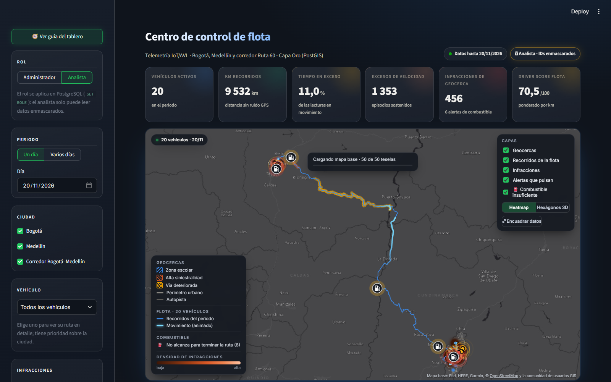
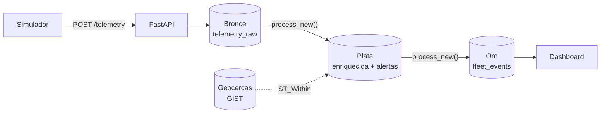

# Fleet Pipeline · Telemetría vehicular geoespacial

[](https://github.com/saul-gut/fleet-pipeline/actions/workflows/ci.yml)

Pipeline de datos geoespaciales para flotas (IoT/AVL) con arquitectura **Bronce → Plata → Oro** sobre **PostgreSQL 16 + PostGIS 3.5**. Recibe telemetría GPS, la valida y la cruza con geocercas. A partir de ahí:

- dispara alertas de velocidad con un límite que depende de la zona;
- predice si el combustible alcanza para terminar la ruta;
- calcula un **Driver Score** diario por vehículo.

Todo se consolida en una tabla para BI que responde en milisegundos sobre millones de registros.



---

## Qué incluye

| Capa | Qué hace | Dónde |
| --- | --- | --- |
| **Bronce** | API FastAPI que recibe lotes de telemetría, valida la calidad del dato (rechaza, ignora duplicados o marca), y guarda en una tabla particionada por día. Un simulador envía la flota por la API en tiempo real o en modo histórico. | [`ingestion/`](src/fleet_pipeline/ingestion), [`api/`](src/fleet_pipeline/api), [`simulator/`](src/fleet_pipeline/simulator) |
| **Privacidad** | Enmascara el ID (`VHC-8472-ABC` → `VHC-****-ABC`) para los no administradores, con roles de PostgreSQL, vistas enmascaradas y una clave sustituta. La base aplica la regla aunque la aplicación falle. | [`05_security.sql`](db/init/05_security.sql), [`security/`](src/fleet_pipeline/security) |
| **Plata** | Cruza cada punto con 25 geocercas construidas con datos oficiales de Bogotá y Medellín (`ST_Within` + GiST). Aplica el límite de la geocerca más restrictiva, agrupa los excesos en episodios y diferencia `SPEEDING` de `GEOFENCE_VIOLATION`. Calcula el consumo real para la alerta `LOW_FUEL_FOR_ROUTE`. | [`08_silver_process.sql`](db/init/08_silver_process.sql), [`rules.py`](src/fleet_pipeline/processing/rules.py) |
| **Oro** | `gold.fleet_events`: tabla consolidada con GiST, GiST parcial, BRIN y partición diaria, sin IDs reales. Driver Score diario normalizado por 100 km. | [`09_gold.sql`](db/init/09_gold.sql) |
| **Tablero** | Streamlit + deck.gl: ruta del vehículo, heatmap o hexágonos de infracciones, geocercas, alertas de combustible, ranking de Driver Score y cambio de rol en vivo (administrador o analista). | [`dashboard/`](dashboard) |

## Arquitectura



La lógica espacial se ejecuta **dentro de PostGIS**, con SQL por lotes e incremental (marca de agua). Python valida, orquesta y especifica las reglas con tests. El detalle está en [DESIGN.md](DESIGN.md).

## Inicio rápido

Requisitos: Docker, Git y [uv](https://docs.astral.sh/uv/). La guía completa, para Windows, macOS y Linux, está en [SETUP.md](SETUP.md).

```bash
git clone https://github.com/saul-gut/fleet-pipeline.git && cd fleet-pipeline
cp .env.example .env              # y cambia las contraseñas
uv sync
uv run python tasks.py up         # PostGIS en Docker, inicializado con db/init/
uv run python tasks.py api        # terminal 1: API en http://localhost:8000/docs
uv run python tasks.py seed       # terminal 2: geocercas, flota, 24 h simuladas y procesamiento
uv run python tasks.py dashboard  # tablero en http://localhost:8501
```

## Resultados medidos

**Benchmark de `gold.fleet_events` con 5 078 880 filas** (mediana de `EXPLAIN ANALYZE`). Detalle en [docs/benchmarks.md](docs/benchmarks.md).

| Consulta de BI | Sin índices | Mejor configuración |
| --- | ---: | ---: |
| Heatmap de infracciones: rectángulo de ~5 × 5 km, 7 días | 189 ms | **24 ms** |
| Ruta de un vehículo en un día | 151 ms | **3,0 ms** |
| Eventos dentro de una zona escolar (`ST_Within`) | 3 228 ms | **84 ms** |
| 10 eventos más cercanos a un punto (KNN) | 818 ms | **0,1 ms** |

**Otros resultados:**

- **Cruce con geocercas:** `ST_Subdivide` llevó el cruce de 113 000 lecturas de 10,7 s a 1,7 s.
- **Consumo estimado:** 35,4–35,9 L/100 km, frente a 35 reales en la simulación.
- **Pruebas:** 231 tests unitarios y de integración contra PostGIS real, con ~90% de cobertura. Corren en CI en cada push.

## Estructura

```text
├── db/init/              # SQL versionado: extensiones, EPSG:9377, capas, roles, procesos
├── src/fleet_pipeline/
│   ├── api/              # FastAPI: ingesta y consultas por rol
│   ├── ingestion/        # validación y reglas de calidad del dato
│   ├── security/         # autenticación por rol y roles de la base
│   ├── geofences/        # carga de geocercas
│   ├── processing/       # reglas de negocio (Python) y orquestación de Plata y Oro
│   ├── queries/          # consultas del tablero
│   └── simulator/        # flota simulada sobre rutas reales
├── dashboard/            # Streamlit + deck.gl
├── data/                 # geocercas y rutas (GeoJSON) con sus fuentes y licencias
├── scripts/              # preparación de datos y benchmark
├── tests/                # unit/ e integration/
├── DESIGN.md             # arquitectura, base de datos, índices y trade-offs
└── SETUP.md              # despliegue local paso a paso
```

## Datos y licencias

- **Geocercas:** perímetros urbanos, colegios y siniestros de fuentes oficiales de Bogotá y Medellín. Las rutas salen de OSRM sobre OpenStreetMap (ODbL). Fuentes, licencias y procesamiento en [`data/geofences/SOURCES.md`](data/geofences/SOURCES.md) y [`data/routes/SOURCES.md`](data/routes/SOURCES.md).
- **Telemetría:** es simulada. No hay datos de vehículos ni de personas reales.

## Uso de inteligencia artificial

Este proyecto se desarrolló con apoyo de un asistente de IA para programación. Las decisiones de diseño, la validación de los datos geográficos y la revisión de los resultados son del autor.

---

**Autor:** Saúl Gutiérrez · Geógrafo, especialista en SIG y analítica territorial.
